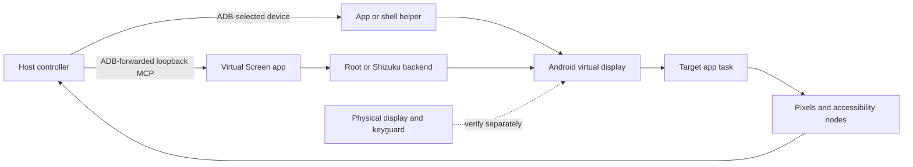

# Android Virtual Screen Field Guide

[Tiếng Việt](README.md) · **English** · [简体中文](README.zh-CN.md) · [한국어](README.ko.md) · [日本語](README.ja.md)

Real-device field notes on controlling Android apps on a separate virtual display while the physical screen remains off. This is a **documentation and reproducibility guide**, not an Android agent, an APK distribution, or a claim that every app works under every lock state.

**Observation date: 2026-11-16 / 2026-11-17.** Versions below are the tested versions, not a promise that they are the newest releases. The published findings are author-reported, sanitized observations. Private device captures and raw logs are intentionally not included, so readers should reproduce the tests rather than treat the repository as independently auditable raw evidence.

## A32 Android 13: new root-hosted route

A separate controller bootstrapped as root UID0, then ran its helper as system UID1000 without Shizuku operations. Live nodes, clicks, Unicode input, capture, 90-second idle and owned-worker timeout cleanup passed while the physical panel remained in DOZE/DOZE_SUSPEND. Direct UID0 still fails package attribution. This is not a stock Root-button or serving-MCP fix; secure keyguard, long idle and reboot remain untested.

[A32 root workflow and evidence boundaries (English)](docs/a32-root-android13.md)

## Pixel 10 Pro XL / Android 17 update

New on 2026-11-17: a custom controller using CompanionDeviceManager (CDM) `APP_STREAMING` + `VirtualDeviceManager`, non-root shell UID `2000`, and no `OWN_DISPLAY_GROUP` flag passed coordinate taps, native swipe, Unicode input and Calculator result 56 while securely locked with the physical display `OFF`. After 308.7 seconds idle without helper calls, a coordinate tap still changed the counter `1 → 2`; physical state was sampled, not continuously monitored. This is not stock MCP/Shizuku integration and did not automatically enable Wireless debugging. Cleanup restored associations/roles and settings and removed session-owned resources.

The historical result remains: VirtualScreen + Shizuku shell passed locked/off semantic click/set-text through an experimental per-display power override, but coordinate taps FAILED in that test. The authorized WhatsApp read/send session was tested only while unlocked, on a virtual display while TikTok remained physical foreground at sampled checks, then WhatsApp was restored to background. Neither locked WhatsApp support, universal app support, absence of transient focus changes nor reboot/network-loss recovery is established.

[Pixel workflow and evidence boundaries (English)](docs/pixel-android17.md)

## Xiaomi Pad Mini / Android 16: three distinct evidence paths

On 2026-11-17, non-root Mika 0.1.44 completed **its own app self-check through the existing serving helper** while securely locked with the physical display `OFF`: 12 pass, 0 partial, 0 fail, 0 skipped in 42 seconds. A separate UI host only temporarily moved Mika's task to a virtual display and operated its UI; the original app/helper processes remained unchanged. The task returned to background before display release, with APK/settings unchanged. This extends the earlier unlocked checks and standalone native probe, but is not model-AI E2E.

A separate locked/off test sent **exactly one** authorized message to the user's own Telegram Saved Messages through a standalone native host from the installed Mika APK + UIAutomation, not serving-helper RPC or AI. Fresh destination/draft readback preceded Send; the UI then showed `Sent`/`Seen`, an empty composer, and the task was restored to background. `Seen` in Saved Messages does not establish another person's read receipt. Physical state and main task were sampled, not continuously traced. Details: [Xiaomi workflow](docs/xiaomi-pad-mini-android16.md) and [acceptance matrix](docs/acceptance-matrix.md).

## The short answer

- **Root is neither necessary nor sufficient.** On a rooted Samsung A32, Virtual Screen's Root backend failed a package/UID check. An ADB-started Shizuku server running as **shell UID 2000** worked.
- **Non-root can work while securely locked.** Mika's own app self-check now passed **12/12 in 42 seconds** through its existing serving helper with the physical display `OFF`. Earlier unlocked checks, the standalone probe and the standalone Telegram test remain distinct paths.
- **Screen off is not the same as secure keyguard.** The A32 tests had no secure keyguard showing. Do not generalize them to PIN/pattern-locked Samsung devices.
- **App self-check is not model-AI E2E.** The new locked check exercised the existing serving helper via Mika's UI. The older probe and Telegram used standalone native paths, not serving-helper RPC. No model or API key was configured; no complete Mika AI task was tested.
- **Recovery now has a bounded positive result.** After direct Mika pairing, an unlocked/`Awake` test kept Wireless debugging on, sent `TERM` to the identity-checked shell helper, and observed a new helper within about 5 seconds without rescue or manual startup. Mika then passed 12/12 in 41 seconds. The earlier locked transport-loss/manual-recovery failure remains unexplained; wireless-off while locked, reboot, long idle and roaming remain untested.

## What was actually tested

| Device / path | Software | Observed result | Evidence boundary |
|---|---|---|---|
| Samsung A32, Android 13 / One UI 5.1, rooted | Virtual Screen 0.2.1, Root backend | `ROOT_OPERATION_FAILED`: `SecurityException: packageName must match the calling uid` | This ROM/backend combination, not all root implementations |
| Same A32, ADB-started Shizuku | Shizuku 13.6.0, Virtual Screen MCP | 19 tools listed; Settings launch, tree reading, tap and typing verified while physical display stayed `DOZE_SUSPEND` | No secure keyguard showing; not all 19 tools retested |
| Same A32, app compatibility check | Virtual Screen 0.2.1 | Initial check: 18/19, with Tap failed | Later bounded tap/type success does not erase that earlier result |
| Historical unlocked Xiaomi Pad Mini, Android 16, non-root | Mika 0.1.44, build `2b26f3f` | Built-in self-check: 12 pass, 0 partial, 0 fail, 0 skipped; baseline 42 seconds, after pairing 41 seconds, after recovery 41 seconds | Unlocked; recovery tested only helper death while `Awake` with Wireless debugging on |
| Earlier standalone Xiaomi probe, securely locked and screen off | Installed Mika APK's `ShellService`, separate temporary shell process | Virtual display, test-page nodes, tap counter and typed-text readback passed; `Asleep`, physical `OFF`, keyguard `showing=true` | Native backend diagnostic, not serving-helper RPC or app/AI E2E |
| Same Xiaomi, securely locked | Same native capture path; TikTok Studio 44.6.3 | App launched and a real 1880×3008 frame was captured; physical display remained off | Read-only launch/capture, no posting or account interaction |
| Same Xiaomi, securely locked, physical `OFF`, 2026-11-17 | Mika app UI through existing serving helper | 12 pass, 0 partial, 0 fail, 0 skipped in 42 seconds | Separate UI host; original app/helper processes unchanged; not model-AI E2E |
| Same Xiaomi, Telegram Saved Messages, locked/off, 2026-11-17 | Standalone installed-APK native host + UIAutomation | Exactly one authorized message; destination/draft checked before Send; UI `Sent`/`Seen`, empty composer | Not serving RPC or AI; `Seen` only in own Saved Messages; task restored to background |

For methodology and unsuccessful attempts, see [Observed results](docs/observed-results.md). The [sanitized data](examples/observations.json) is a summary, not a raw trace.

## Choose a solution

| Situation | Practical starting point | Important limitation |
|---|---|---|
| Rooted phone, existing `su` works | Try the application's supported Root backend with an app-specific grant | Root does not bypass Android package attribution, display policy or ROM behavior |
| Root path fails, USB/authorized wireless ADB is available | Run Shizuku through **ADB**, then authorize only the target app | Verify UID 2000. Starting Shizuku with root is a different execution identity |
| Non-root Android with Mika support | Install Mika; use computer-start or direct pairing in Mika | Mac-to-device ADB trust is not Mika's own pairing; the later Mika UI showed `Paired`/`Connected` |
| No root and no ADB/helper | Consider ordinary app APIs or a user-consented MediaProjection workflow | These do not grant arbitrary cross-app input or automatically provide a private background app display |
| Sensitive/protected apps or content | Test the specific app and honor its normal authentication and capture rules | Blank or blocked protected content is not a reason to defeat those rules |

Detailed instructions: [Root / non-root solutions](docs/solutions.md) · [Troubleshooting](docs/troubleshooting.md) · [Reproduction checklist](docs/reproduce.md).

## How the pieces fit

These are **different control paths**, not interchangeable names:

1. **Virtual Screen + MCP:** app-level authorization, session, control lease, current observation, action, readback, restore the agreed background task before closing the display, then release owned leases/sessions/resources.
2. **Mika's app workflow:** the new locked/off app self-check used its existing serving helper and passed 12/12 in 42 seconds. A separate UI host only moved/captured/clicked Mika. No model-AI task was run.
3. **Standalone native path:** the earlier probe and the Telegram test used the installed Mika APK's backend; Telegram added UIAutomation, not serving-helper RPC. This established a device/backend capability; it did not establish Mika app-level orchestration or expose a production remote-control endpoint. The version-coupled experimental harness is not shipped here as a supported SDK.

## A32: historical stock Root failure and shell Shizuku fallback

The stock Root backend failed package/UID attribution, while ADB-started shell UID `2000` Shizuku passed the bounded fallback tests. This is distinct from the newer root-bootstrapped system UID `1000` controller summarized above and documented in the [A32 root guide](docs/a32-root-android13.md); it does not fix the stock Root backend.

## Mika pairing and bounded recovery

Mika 0.1.44 on the non-root Android 16 Pad Mini initially used the documented computer-start script `usb-start.sh`. Later, direct pairing through Mika's own UI showed `Paired`/`Connected`. Existing `WRITE_SECURE_SETTINGS` permission and Wi-Fi trust were already present; both recovery toggles were already enabled. Direct pairing satisfied their missing prerequisite rather than newly enabling those settings.

The new test checked the shell helper's identity before `TERM` and observed an app-created replacement within about 5 seconds, while unlocked/`Awake` with Wireless debugging left on. No rescue or manual startup was used. Mika's own post-recovery self-check reported 12 pass, 0 partial, 0 fail, 0 skipped in 41 seconds; baseline 42 seconds and post-pairing 41 seconds also passed 12/12.

The earlier locked-session transport disappearance and manual recovery remain part of the record, with no established cause. This helper-only recovery result does not test wireless-off plus locked state, reboot, long idle or roaming, and is not an AI E2E result. See [Wireless debugging and recovery](docs/wireless-debugging.md).

## Minimal operating rules

- Select a device by a newly verified model and serial. Every ADB command must include `-s "$SERIAL"`; never rely on the default connected device.
- Keep the service on loopback. Do not expose a bearer-authenticated device controller on a public tunnel just to obtain a screenshot.
- Read tokens only through the application's supported UI/configuration. Never put them in shell history, repository files, screenshots or logs.
- ADB shell root, an app-specific `su` grant, Shizuku permission and accessibility permission are different grants. Keep unrelated grants and services intact.
- Inspect before input. Use a current observation and the correct display. If a tap's delivery is uncertain, read the state before deciding whether another action is needed.
- Do not force-stop an app just because it already has a task on another display. A draft or other transient state may be lost. Observe the tool's approval flow.
- Check **physical-display state**, virtual-display state and keyguard separately. Device-wide `Awake` can coexist with a physical panel in `DOZE_SUSPEND` because a virtual display is active.
- Restore the agreed background task/focus before closing the test display, then release owned leases/sessions/resources and verify the result. Keep successful configuration separate from disposable test cleanup. Source rollback does not restore phone state or retract sent messages.

## Reproduce, then make claims

The suggested progression is:

1. Verify the selected device and the official APK's identity/hash.
2. Establish the correct backend identity and app-specific permissions.
3. Run the app's self-check while unlocked; fix the failed prerequisite and rerun affected checks.
4. Test a harmless Settings/test-page flow on a virtual display with visible output and input readback.
5. With the user explicitly controlling the lock state, repeat bounded tests while the physical screen is off. Record whether secure keyguard is actually showing.
6. Check lifecycle failures separately: transport loss, helper death and reboot recovery are different tests.
7. Publish only sanitized results, not tokens, network identifiers, account data or private screenshots.

## Documentation

- [Observed results and boundaries](docs/observed-results.md)
- [Root and non-root solutions](docs/solutions.md)
- [Reproduction and cleanup](docs/reproduce.md)
- [Failure diagnosis](docs/troubleshooting.md)
- [Publication hygiene](docs/privacy.md)
- [Primary sources](docs/sources.md)

## License and attribution

This guide and its original examples use the [MIT license](LICENSE). Upstream applications retain their own licenses. This repository does not redistribute their APKs, source trees, credentials or private captures, and is not affiliated with their maintainers. Follow the linked official projects for installation details and version-specific changes.
