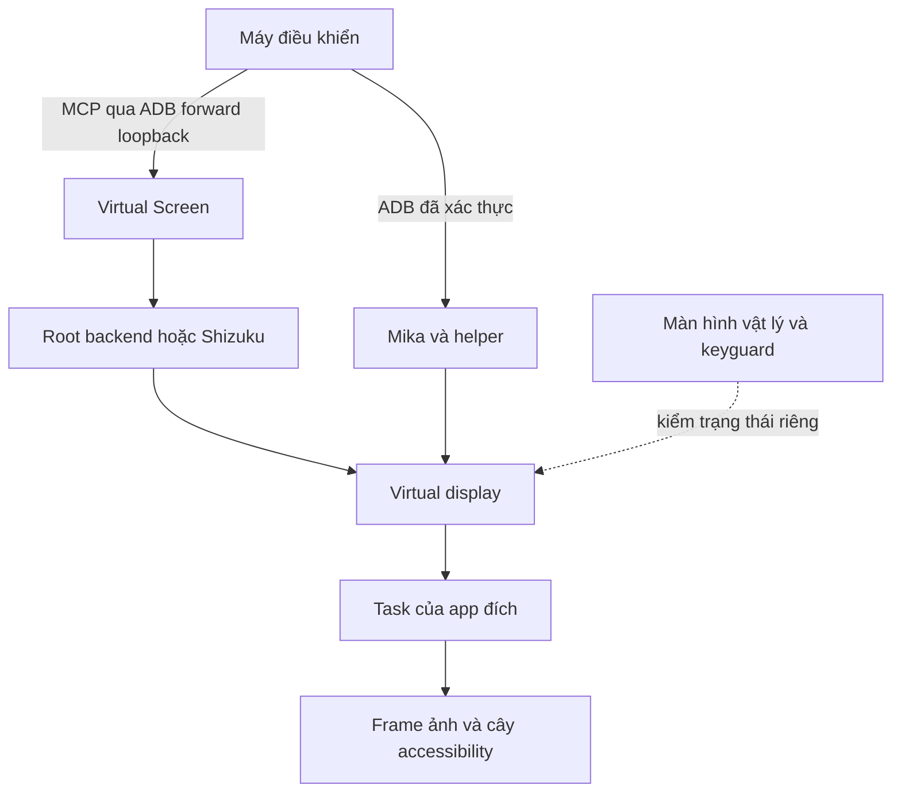

# Android Virtual Screen Field Guide

**Tiếng Việt** · [English](README.en.md) · [简体中文](README.zh-CN.md) · [한국어](README.ko.md) · [日本語](README.ja.md)

Ghi chép thực nghiệm điều khiển ứng dụng Android trên **màn hình ảo riêng**, trong khi màn hình vật lý vẫn tắt. Đây là repo **tài liệu và hướng dẫn tái lập**, không phải một Android agent hoàn chỉnh hay nơi phân phối APK.

**Ngày kiểm chứng: 16/11/2026.** Các phiên bản nêu dưới đây là bản đã thử, không mặc định là bản mới nhất. Kết quả được tác giả tổng hợp từ phiên chạy thật; ảnh và log riêng tư không được công khai. Người đọc cần tự tái lập, không coi các bảng tổng hợp trong repo là raw evidence có thể audit độc lập.

## Pixel 10 Pro XL / Android 17: kết quả mới

Non-root với VirtualScreen + Shizuku shell: đã kiểm MCP semantic click/set-text trên probe khi máy khóa/tắt, qua workaround nguồn riêng cho display. Coordinate tap lúc khóa vẫn FAIL. Khi mở khóa, đã đọc/gửi tin theo yêu cầu trên WhatsApp ở màn hình ảo trong khi TikTok vẫn foreground ở các lần kiểm, rồi trả WhatsApp về nền. Không tự bật Wireless debugging; chưa bảo đảm mọi app hoặc không giành focus thoáng qua.

[Pixel workflow and evidence boundaries (English)](docs/pixel-android17.md)

## Kết luận ngắn

1. **Có root chưa chắc chạy được; không root vẫn có thể chạy.** A32 đã root nhưng Root backend của Virtual Screen bị lỗi package/UID. Đổi sang Shizuku chạy bằng ADB, UID `2000(shell)`, thì luồng kiểm tra hoạt động.
2. **Tắt màn hình khác với khóa PIN/pattern.** A32 được kiểm ở trạng thái màn hình tắt nhưng `keyguard showing=false`. Không dùng kết quả đó để khẳng định đã kiểm khóa bảo mật.
3. **Pad Mini non-root đã đạt 12/12 self-check khi mở khóa.** Khi khóa thật, một tiến trình chẩn đoán dùng backend native của APK Mika cũng mở app, đọc, chạm và gõ được. Tuy nhiên đó không phải self-check của app hoặc tác vụ AI trọn luồng.
4. **Khôi phục helper đã có bằng chứng giới hạn mới.** Sau khi Mika pair trực tiếp qua UI, thử khi mở khóa/`Awake`, giữ Wireless debugging bật: dừng đúng shell helper bằng `TERM`, app tự tạo helper mới trong khoảng 5 giây, không rescue hay start thủ công; self-check sau đó đạt 12/12 trong 41 giây. Lỗi mất kết nối khi khóa trước đó vẫn được giữ, nguyên nhân chưa rõ; chưa kiểm tắt Wireless debugging khi khóa, reboot, long idle hoặc roaming.

## Ma trận đã kiểm

| Thiết bị / cách chạy | Kết quả quan sát | Giới hạn |
|---|---|---|
| Samsung A32, Android 13 / One UI 5.1, đã root; Virtual Screen 0.2.1 Root backend | `ROOT_OPERATION_FAILED`, chi tiết `SecurityException: packageName must match the calling uid` | Kết quả của ROM/backend này, không khái quát mọi máy root |
| A32, Shizuku 13.6.0 khởi động qua ADB | MCP liệt kê 19 tools; mở Settings, đọc node, chạm và gõ đã kiểm khi màn hình vật lý `DOZE_SUSPEND` | Không có keyguard bảo mật đang hiển thị; không phải toàn bộ 19 tools đều được chạy lại |
| Self-check UI của Virtual Screen trên A32 | Lượt đầu 18/19, Tap lỗi | Lượt tap/type riêng sau đó thành công không xóa kết quả lỗi ban đầu |
| Xiaomi Pad Mini, Android 16, non-root, Mika 0.1.44 build `2b26f3f` | Self-check trong app đều 12 pass, 0 partial, 0 fail, 0 skipped: baseline 42 giây, sau pairing 41 giây, sau recovery 41 giây | Kiểm khi mở khóa; recovery chỉ thử helper chết khi `Awake`, Wireless debugging bật |
| Pad Mini, khóa thật và màn hình tắt | Backend native của APK đang cài: tạo display, đọc node, tap tăng bộ đếm, gõ có readback; `Asleep`, `OFF`, `showing=true` | Tiến trình shell chẩn đoán riêng, không gọi RPC helper đang phục vụ Mika, không phải app/AI E2E |
| Pad Mini khóa thật, TikTok Studio 44.6.3 | Mở app và chụp frame thật 1880×3008 trên virtual display | Chỉ mở/chụp; không đăng bài hoặc thao tác tài khoản |

Chi tiết lịch sử pass/fail và cách nghiệm thu: [Observed results](docs/observed-results.md). [Dữ liệu tổng hợp](examples/observations.json) không phải log gốc.

## Chọn hướng nào?

| Tình huống | Hướng thực tế | Điểm dễ hiểu nhầm |
|---|---|---|
| Máy đã root, `su` hoạt động | Thử Root backend chính thức với grant riêng cho đúng app | Root không tự vượt được kiểm tra package attribution hoặc chính sách display của ROM |
| Root backend lỗi, ADB đang dùng được | Chạy **Shizuku bằng ADB**, cấp quyền cho đúng app | Shizuku chạy bằng root và chạy bằng shell là hai identity khác nhau |
| Non-root, dùng Mika | Cài app; chọn script computer-start hoặc pair trực tiếp trong Mika | Mac đã paired ADB không có nghĩa Mika đã paired riêng; lần mới UI Mika đã hiện `Paired`/`Connected` |
| Không root và không ADB/helper | Xem API thông thường hoặc MediaProjection với sự đồng ý của user | Không tự có quyền nhập liệu xuyên app hay mở app khác trên màn hình nền riêng |
| App có xác thực hoặc nội dung được bảo vệ | Kiểm riêng app, theo luồng xác thực/chụp màn hình bình thường | Không vô hiệu hóa bảo vệ để biến ảnh đen thành ảnh chụp |

Xem hướng dẫn đầy đủ: [Giải pháp root/non-root](docs/solutions.md), [Chẩn đoán lỗi](docs/troubleshooting.md), [Tái lập từng bước](docs/reproduce.md).

## Ba tầng cần phân biệt

- **Virtual Screen + MCP:** quản lý session, lease điều khiển, observation hiện hành, input, readback và cleanup.
- **Mika trong app:** helper, Accessibility, orchestration và model nếu được cấu hình. Phiên thực nghiệm này không nhập model/API key.
- **Native diagnostic:** tiến trình shell tạm gọi `ShellService` từ APK Mika đang cài. Đây là phép kiểm khả năng backend/thiết bị, không chứng minh toàn bộ agent hoạt động. Harness thử nghiệm phụ thuộc phiên bản không được đóng gói ở đây thành SDK hỗ trợ chung.

## Root: kinh nghiệm từ A32

Root đã tồn tại trước phiên thử; hướng dẫn này không flash máy, unlock bootloader hay cài root. Shell `su` vẫn hoạt động nhưng việc tạo display bằng Root backend bị ROM từ chối do package không khớp calling UID.

Cách đã chạy được là cài Shizuku chính thức, dùng **lệnh start qua ADB**, kiểm tiến trình server thuộc shell, rồi đổi backend của Virtual Screen sang Shizuku. Không thêm grant root cho Shizuku và không cấp quyền toàn cục cho app khác.

MCP chỉ nghe loopback; `adb forward` nối máy điều khiển tới cổng đó. Không bật tunnel public. Token lấy bằng UI/config chính thức, giữ ngoài repository và lịch sử lệnh. Luồng đúng là initialize, initialized, tools/list, acquire, create, launch/observe/action, close, release và DELETE session. Xem ví dụ và điều kiện từng bước trong tài liệu liên kết.

## Non-root: kinh nghiệm từ Pad Mini

Ban đầu Mika 0.1.44 dùng helper start từ máy tính qua kết nối ADB đã có, bằng script chính thức `usb-start.sh`. Lần mới đã pair trực tiếp trong UI Mika và quan sát `Paired`/`Connected`. Mac đã paired ADB vẫn không tương đương Mika đã paired.

Các thiết lập đã có sẵn gồm Accessibility bound, thông báo được phép, pin không hạn chế, autostart, khóa app trong Recent apps, `WRITE_SECURE_SETTINGS` và Wi-Fi trust. Hai tùy chọn recovery vốn đã bật; pairing trực tiếp nay đáp ứng prerequisite còn thiếu, không phải vừa bật các quyền hay tùy chọn đó. Không suy thành bảo đảm helper sống mãi hoặc tự phục hồi sau reboot.

Self-check đầu tiên đạt 11 pass và 1 partial do thông báo tắt. Sau khi bật thông báo, chạy lại được 12/12. Không hạ tiêu chí hoặc bỏ qua mục lỗi.

Khi khóa, đã kiểm riêng backend native và chụp được TikTok Studio trong khi panel vẫn `OFF`. Không nhập PIN/pattern, không bỏ keyguard. Ở phiên cũ, Wireless ADB mất và phải start lại helper thủ công; nguyên nhân chưa rõ, kết quả mới không xóa failure đó.

Lần mới chỉ thử helper chết khi mở khóa/`Awake` và Wireless debugging vẫn bật: kiểm identity shell helper trước `TERM`, quan sát helper mới sau khoảng 5 giây, không rescue/manual start; self-check của chính Mika đạt 12 pass, 0 partial, 0 fail, 0 skipped trong 41 giây. Baseline 42 giây và sau pairing 41 giây cũng đều 12/12. Chưa kiểm Wireless debugging tắt khi khóa, reboot, long idle hoặc roaming. Xem [Wireless debugging và recovery](docs/wireless-debugging.md).

## Quy tắc tái lập

- Luôn dùng `adb -s "$SERIAL"` sau khi đối chiếu model và serial live; serial mDNS có thể đổi.
- Phân biệt ADB shell root, app `su`, quyền Shizuku và Accessibility. Giữ nguyên grant/service ngoài phạm vi.
- Kiểm màn hình vật lý theo display, không chỉ đọc `mWakefulness`: virtual display ON có thể làm giá trị tổng là `Awake` dù panel vẫn `DOZE_SUSPEND`.
- Mỗi thao tác cần observation mới và đúng display. Nếu không rõ thao tác đã gửi hay chưa, đọc lại trạng thái trước khi gửi lần nữa.
- Không tự force-stop app có task trên màn hình khác: có thể mất draft. Tôn trọng luồng xác nhận restart của công cụ.
- Nếu thử chuyển task thay vì restart, ghi lại task/display/focus ban đầu và xác minh khôi phục sau chụp; đây là cách chẩn đoán phụ thuộc ROM, không phải lệnh dùng mù cho mọi máy.
- Kết thúc bằng close display, release lease/session, dọn file thử và đọc lại trạng thái. Rollback code bản sao không đồng nghĩa đã rollback điện thoại.

## Bản public không chứa raw evidence riêng tư

Các bảng trên là bản tổng hợp do tác giả báo cáo. Để tự xác nhận, chạy checklist trên thiết bị của bạn và ghi rõ backend, identity, trạng thái từng display, keyguard và state delta sau input. Không suy từ một ảnh chụp hoặc mã trả về thành thành công của toàn bộ luồng.

## Đọc tiếp

- [Kết quả thực nghiệm và giới hạn](docs/observed-results.md)
- [Giải pháp root/non-root](docs/solutions.md)
- [Hướng dẫn tái lập và cleanup](docs/reproduce.md)
- [Chẩn đoán theo triệu chứng](docs/troubleshooting.md)
- [Bảo vệ dữ liệu khi chia sẻ](docs/privacy.md)
- [Nguồn chính thức](docs/sources.md)

## Giấy phép

Tài liệu và ví dụ tự viết dùng [MIT](LICENSE). Mỗi dự án upstream giữ giấy phép riêng. Repo không phân phối APK, source tree upstream, token, serial cá nhân hay ảnh tài khoản thật; không đại diện cho các tác giả ứng dụng.
